<p align="center">
  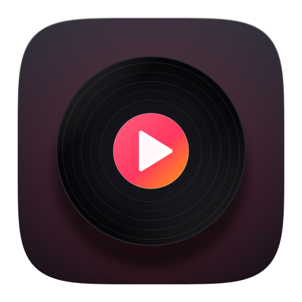
</p>

<h1 align="center">control</h1>

<p align="center">Lecteur musique et vidéo pour Windows et Linux : téléchargements yt-dlp (YouTube, SoundCloud…), éditeur de tags, paroles synchronisées, statistiques d’écoute, films, séries et animés, Discord Rich Presence.<br>
Un design façon macOS : verre dépoli, pochettes qui teintent la fenêtre, animations à ressort, et des ambiances en un clic.</p>

<p align="center">
  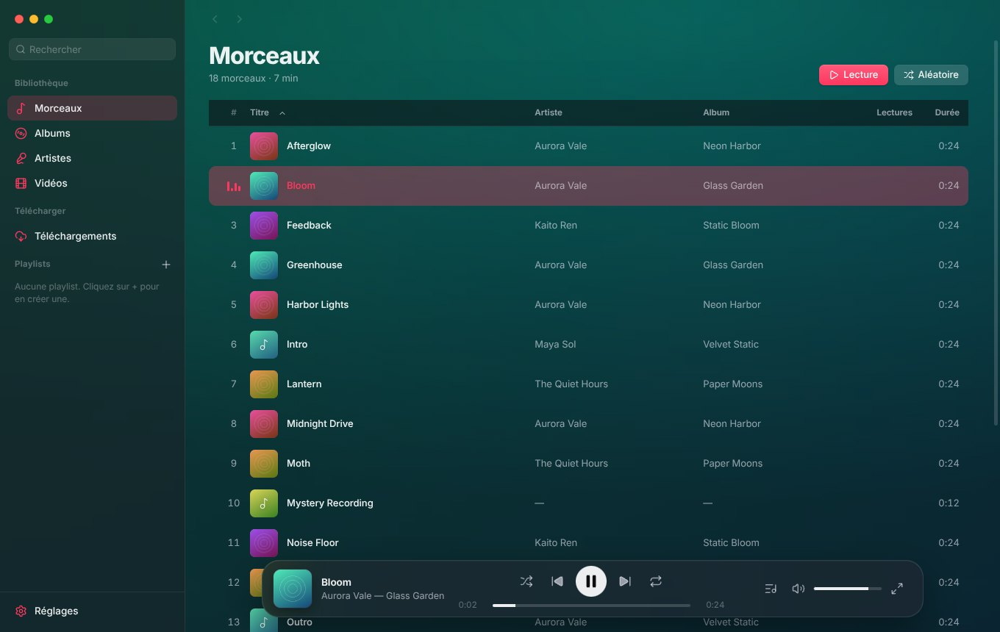
  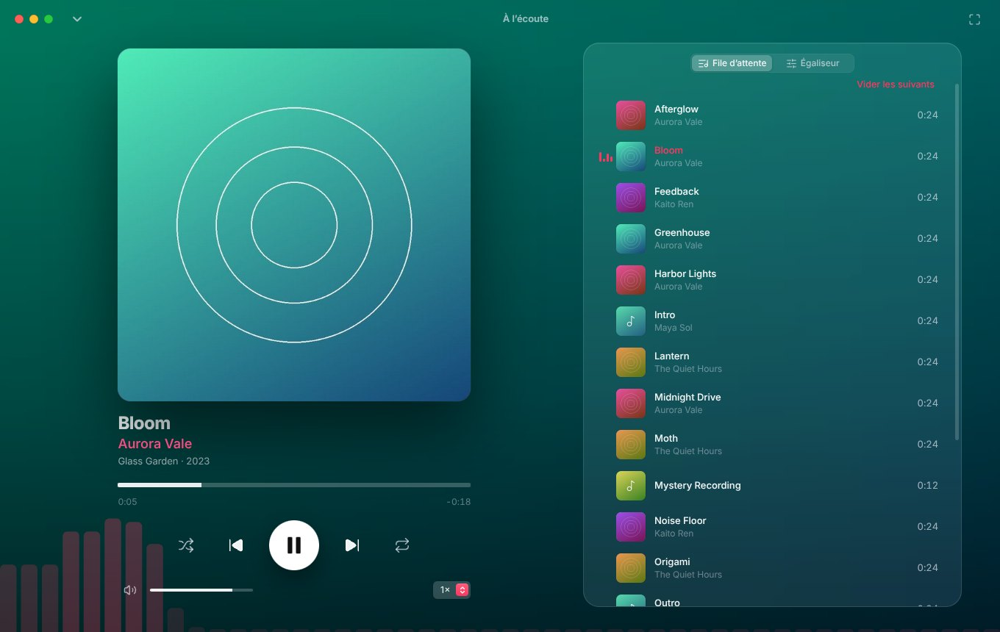
  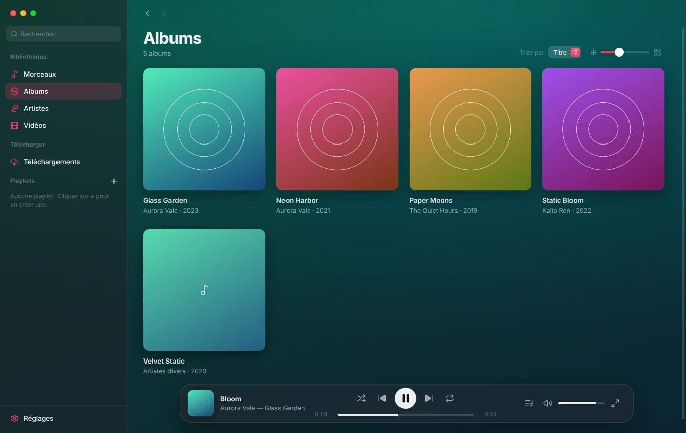
  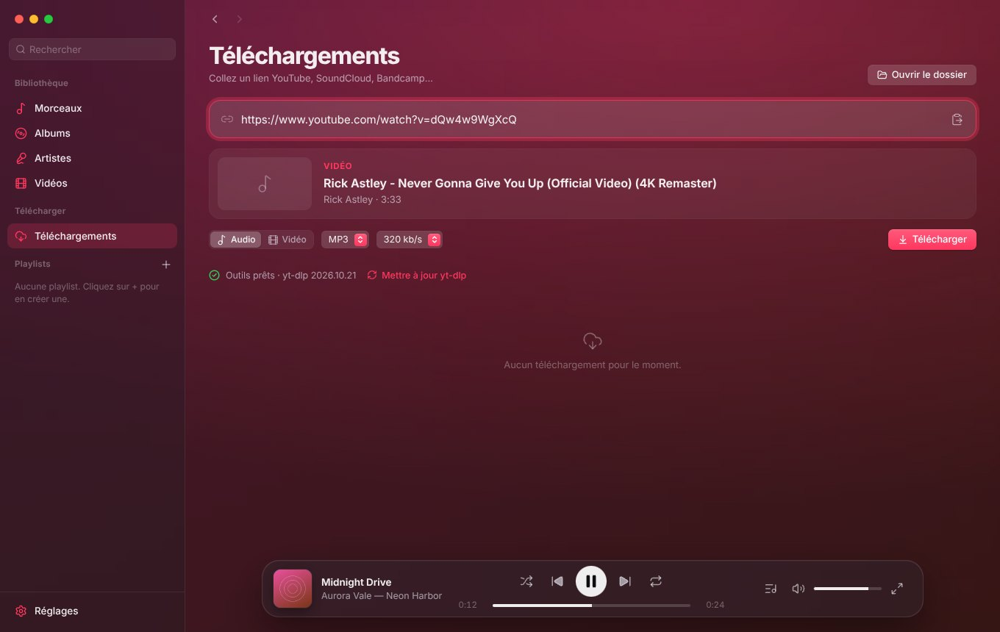
  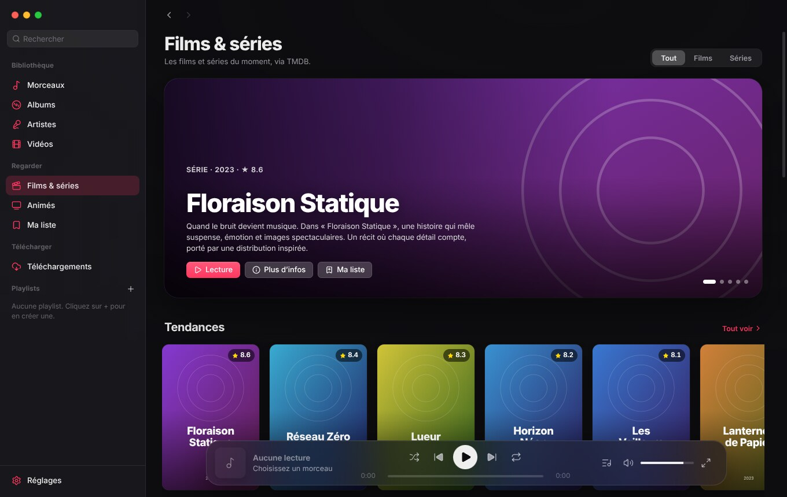
  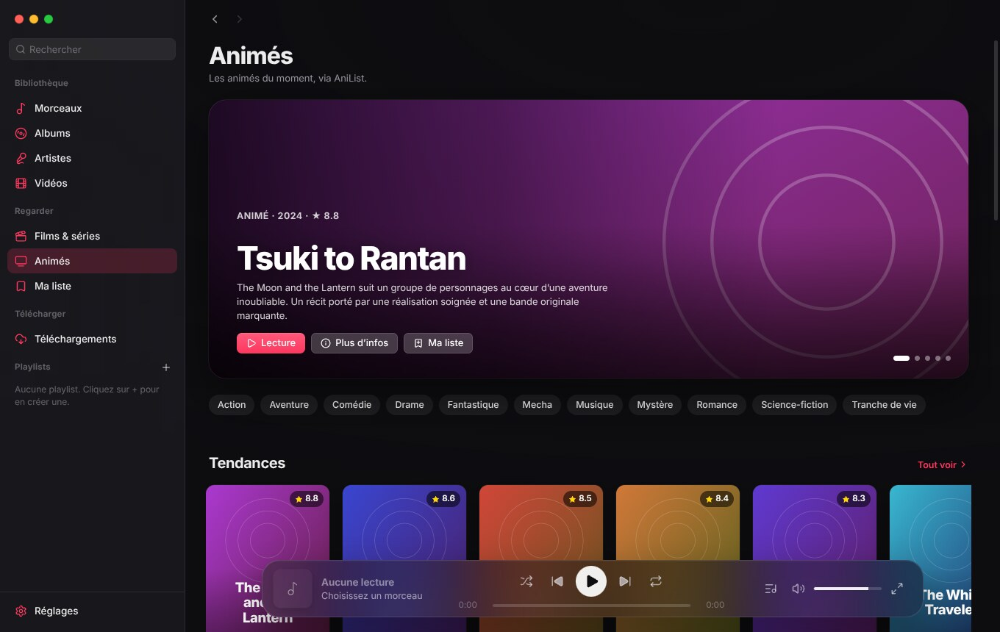
</p>

<sub>Captures réalisées avec une bibliothèque de test et un catalogue fictif générés pour l’occasion (les affiches sont des illustrations).</sub>

## Télécharger

Chaque build est produit par GitHub Actions et publié dans **Releases** :

| Fichier | Pour qui |
| --- | --- |
| `control-<version>-setup.exe` | **Installateur** : raccourcis Bureau et menu Démarrer, désinstallation depuis les Paramètres Windows. |
| `control-<version>-portable.exe` | **Portable** : un seul fichier. La bibliothèque, les réglages et les outils vont dans un dossier `control data` posé à côté. |

| `control-<version>-x86_64.AppImage` | **Linux, un seul fichier** : `chmod +x control-*.AppImage` puis double-clic ou `./control-*.AppImage`. Se met à jour tout seul depuis l’application. |
| `control-<version>-amd64.deb` | **Linux (Debian, Ubuntu et dérivés)** : `sudo apt install ./control-*.deb`. Une nouvelle version est signalée dans l’application ; le paquet se télécharge à la main. |

L’exécutable Windows n’est pas signé : au premier lancement, SmartScreen peut afficher « Windows a protégé votre ordinateur ». Clique sur **Informations complémentaires** → **Exécuter quand même**.

**Linux** : 64 bits (x86_64) uniquement. L’AppImage demande FUSE 2 sur Ubuntu 22.04 et plus récent (`sudo apt install libfuse2t64`, ou `libfuse2` avant 24.04) ; sans FUSE : `./control-*.AppImage --appimage-extract-and-run`. Sur les distributions qui interdisent l’espace utilisateur isolé (Ubuntu 24.04…), l’AppImage ne peut pas installer le bac à sable de Chromium et démarre sans lui ; le paquet .deb, lui, installe ce qu’il faut. Les outils de téléchargement (yt-dlp, ffmpeg, deno) sont téléchargés au premier besoin ; l’extraction demande `tar` et `unzip` (`sudo apt install unzip xz-utils`), et un ffmpeg déjà installé sur le système est utilisé tel quel. Les touches multimédia et le panneau du bureau passent par MPRIS (non vérifié sur toutes les distributions).

## Premiers pas

1. **Ajoute ta musique** : bouton *Ajouter mon dossier Musique* au premier lancement, ou glisse des fichiers et des dossiers dans la fenêtre. Les dossiers ajoutés sont surveillés : un nouveau fichier apparaît tout seul au bout de quelques secondes.
2. **Télécharge** (facultatif) : onglet *Téléchargements* → *Installer* (yt-dlp, ffmpeg et deno sont téléchargés une seule fois), puis colle un lien.
3. **Écoute** : double-clic sur un morceau, ou `Espace`.
4. **Regarde** (facultatif) : les *Animés* fonctionnent tout de suite. Pour les *Films & séries*, colle une clé TMDB gratuite (carte au premier affichage, ou *Réglages* → *Streaming*, voir plus bas).

## Ce qu’il y a dedans

**Lecteur**
- Audio (MP3, FLAC, M4A, AAC, OGG, Opus, WAV) et vidéo (MP4, MKV, WebM, MOV) dans la même app.
- File d’attente modifiable par glisser-déposer, aléatoire, répétition (tout / un seul), vitesse de lecture.
- **Égaliseur 10 bandes** avec 10 préréglages.
- **Fondu enchaîné** réglable de 1 à 12 s (*Réglages* → *Général*) : la fin d’un morceau se mêle au début du suivant, à puissance constante.
- **Paroles synchronisées** : onglet *Paroles* de « À l’écoute » (`L`). Les lignes défilent avec la musique, un clic sur une ligne s’y rend. Elles viennent d’un fichier `.lrc` posé à côté du morceau, des paroles intégrées au fichier, ou de [LRCLIB](https://lrclib.net) (gratuit, sans compte) ; une fois trouvées, elles sont gardées. On peut aussi en coller, ou les enregistrer en `.lrc`.
- Touches multimédia du clavier et panneau multimédia de Windows (pochette, titre, position).
- Reprise de la session au lancement (file d’attente, morceau, position).
- Écran **À l’écoute** plein fenêtre sur fond de pochette floutée ; la vidéo y passe en grand, avec une interface qui se masque d’elle-même.
- **Vraie barre de contrôle pour les vidéos** : barre de progression, ±10 s, précédent / suivant, volume, vitesse, image dans l’image et **plein écran** (`F`, `Échap` pour en sortir).

**Bibliothèque**
- Analyse incrémentale (rescan quasi instantané), tags et pochettes lus dans les fichiers, ou `cover.jpg` / `folder.jpg` du dossier.
- Vues *Morceaux* (liste virtualisée, tri par colonne), *Albums* (taille réglable), *Artistes*, *Vidéos*.
- Recherche instantanée dans les morceaux, albums, artistes, vidéos et playlists.
- Menu contextuel partout : lire, lire ensuite, ajouter à la file ou à une playlist, aller à l’artiste, afficher dans le dossier, supprimer (avec corbeille en option).

**Éditeur de tags** (clic droit → *Modifier les tags…*, ou `Ctrl` + `I`)
- Un ou plusieurs morceaux à la fois : titre, artiste, artiste de l’album, album, genre, année, piste et disque, compositeur, commentaire, paroles. Les champs qui diffèrent d’un morceau à l’autre affichent « Plusieurs valeurs » et ne sont touchés que si tu les modifies ; on peut aussi passer d’un morceau à l’autre dans la sélection.
- **Pochette** : choisir une image, la glisser sur la pochette, la retirer, ou **la chercher en ligne** (Apple Music et Deezer).
- **Outils par lot**, avec aperçu avant d’appliquer : *tags depuis le nom du fichier* (`%artist% - %title%`…), *renommer les fichiers depuis les tags*, *numéroter les pistes*, *remplacer* (texte ou expression régulière), *casse*, *nettoyer* (« (Official Video) », espaces en trop).
- MP3, FLAC, M4A, OGG, Opus, WAV : les tags sont écrits dans le fichier, sans le réencoder. Rien n’est écrit tant que tu n’as pas cliqué sur *Enregistrer*, et le dernier lot peut être **annulé**. Les lectures et les playlists suivent un fichier renommé.

**Statistiques** (barre latérale → *Statistiques*)
- Temps d’écoute, lectures, morceaux et artistes différents, série de jours d’écoute, sur 7 jours, 30 jours, l’année ou tout l’historique.
- Histogramme des jours, calendrier de l’année, heures et jours de la semaine préférés, tops des morceaux, artistes, albums et genres (un clic lance la lecture ou ouvre la page).
- Films, séries et animés : temps de visionnage, titres les plus regardés, genres.
- **Récap** façon « Wrapped » : une suite de cartes plein écran, avec une image à enregistrer pour la partager. Un par année **et un par mois** (menu *Récap* de la page, ou la notification qui apparaît en début de mois).

<p align="center">
  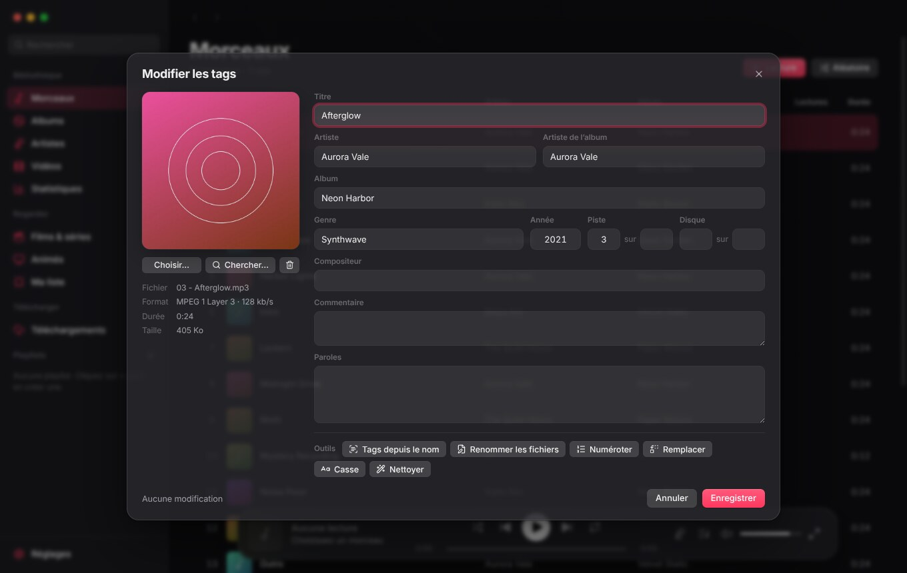
  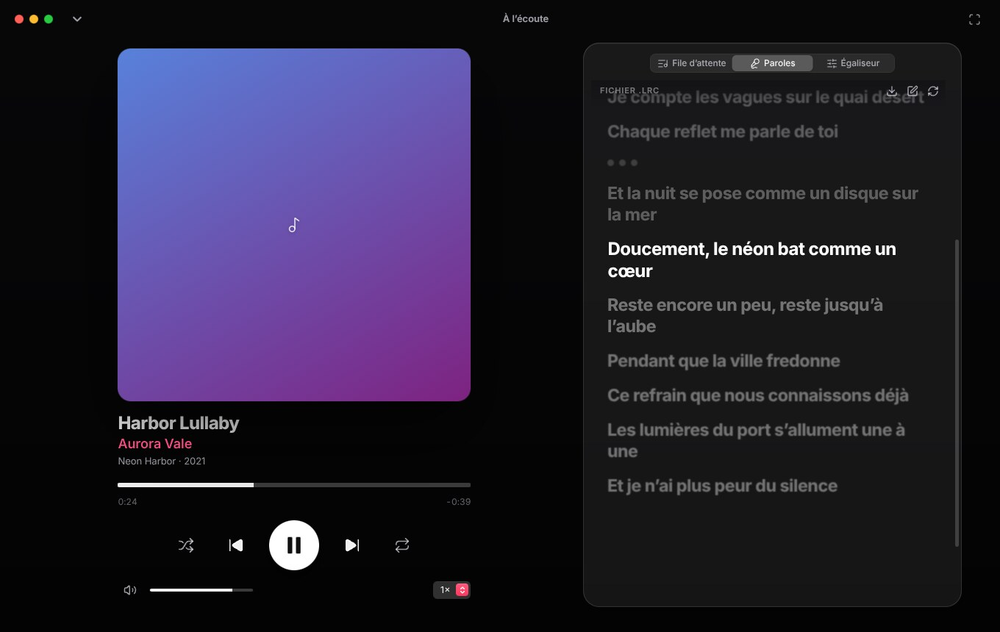
  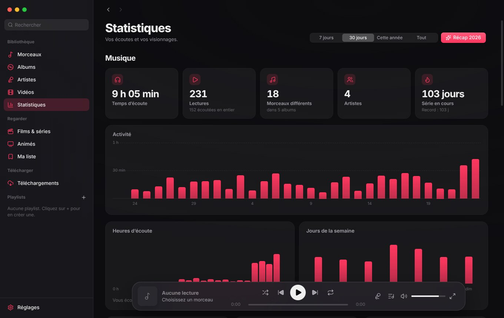
  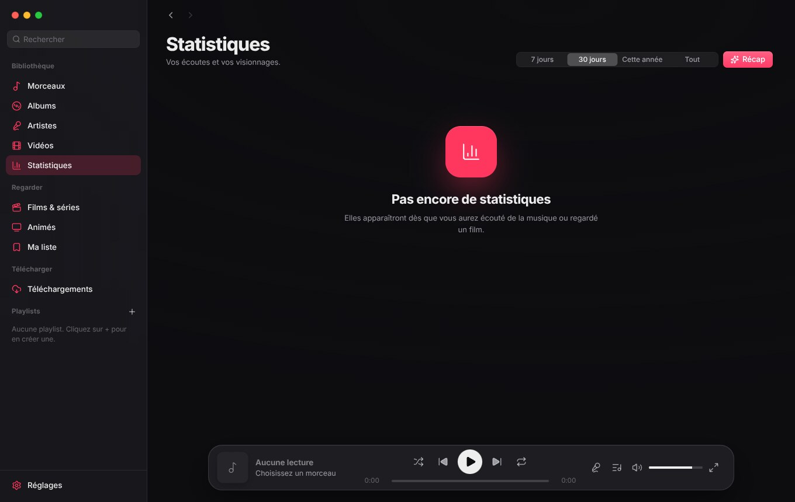
</p>

**Playlists**
- Classiques : glisser des morceaux depuis n’importe quelle vue, réordonner par glisser-déposer.
- **Intelligentes** : règles combinables (lectures, dernière écoute, date d’ajout, genre, artiste, album, année, durée), tri, limite, aperçu du nombre de résultats. Modèles prêts à l’emploi : les plus écoutés, ajoutés récemment, jamais écoutés, écoutés récemment.
- Import et export M3U / M3U8.

**Téléchargements (yt-dlp)**
- Colle un lien YouTube, SoundCloud, Bandcamp… (vidéo, morceau, playlist ou « set ») : l’appli l’analyse et affiche titre, durée et vignette.
- **Recherche sans lien** : tape un titre ou un artiste, choisis *SoundCloud* ou *YouTube*, et télécharge directement un résultat.
- Audio MP3 (128–320 kb/s), M4A, Opus, FLAC ou original ; vidéo MP4 de 480p jusqu’à la 4K.
- Titre, artiste et pochette intégrés au fichier ; « Artiste - Titre » découpé automatiquement, et les « (Official Video) », « [Lyrics] » retirés du titre.
- File avec progression, vitesse, temps restant, annulation et nouvel essai ; les playlists créent une playlist dans l’appli.
- **Mise à jour automatique de yt-dlp** une fois par jour (YouTube casse régulièrement les anciennes versions).
- *Cookies du navigateur* en option, pour les vidéos qui demandent de se connecter ou de prouver qu’on n’est pas un robot. Firefox marche le mieux ; Chrome, Edge et Brave chiffrent leurs cookies sous Windows (« Could not copy Chrome cookie database ») : on peut alors choisir un **fichier `cookies.txt`** exporté du navigateur (extension « Get cookies.txt LOCALLY »), qui passe avant le réglage du navigateur.

**Films, séries et animés**
- Accueil *Films & séries* (tendances, au cinéma, populaires, les mieux notés, séries en cours de diffusion, genres) et accueil *Animés* (tendances, saison en cours, populaires, films), avec un bandeau de mise en avant, des rangées à défilement et « Tout voir ».
- Fiches détaillées : synopsis, note, genres, distribution, bande-annonce, liste des saisons et des épisodes, titres liés ou recommandés, date du prochain épisode pour les animés.
- Lecture dans l’appli avec [vidrift](https://vidrift.net) (lecteur intégré, plein écran géré par la fenêtre) : **reprise automatique** là où tu t’es arrêté, épisode précédent / suivant, doublage anglais en option pour les animés.
- **Continuer à regarder**, historique, **Ma liste**, et recherche en ligne dans la barre de gauche (elle cherche aussi bien dans ta bibliothèque que dans les catalogues).
- Métadonnées : [TMDB](https://www.themoviedb.org) pour les films et séries (clé gratuite à coller dans les réglages), [AniList](https://anilist.co) pour les animés (aucune clé). Les catalogues sont mis en cache et restent consultables quelques heures sans réseau.

**Apparence** (*Réglages* → *Apparence*)
- Par défaut, control garde son look d’origine (verre dépoli, pochettes qui teintent la fenêtre). Les ambiances sont là si tu veux autre chose.
- **12 ambiances** en un clic : *control* (l’apparence d’origine), Ember, Midnight, Forêt, Ocean, Iris, Sakura, Gold, Blood Moon, Snowfall, Cyberpunk, Monochrome. Tu peux **enregistrer la tienne** à partir de l’apparence actuelle, et revenir à *control* d’un clic.
- Thème clair, sombre, automatique ou **OLED** (noir profond, profondeur réglable), 8 couleurs d’accentuation macOS et une couleur libre.
- **16 fonds animés** (braises, étoiles, lucioles, ondes, nébuleuse, pluie, plasma, météores, neige, hyperespace, grille, bulles, constellation, brume, aurore) : vitesse et flou réglables ; ils se mettent en pause quand la fenêtre est inactive ou que les animations sont coupées.
- Arrondi des coins, translucidité et taille de l’interface réglables ; listes compactes ; animations désactivables.
- Interface en français ou en anglais.

<p align="center">
  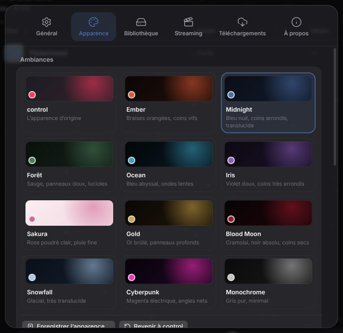
</p>

**Discord Rich Presence** (*Réglages* → *Général* → *Discord*)
- Affiche sur ton profil « Écoute control » (titre, artiste, **pochette du fichier**, barre de progression) ou « Regarde control » (vidéo, film, série, épisode, affiche), avec une pastille lecture / pause.
- Activable séparément pour la musique, les vidéos et le streaming ; option **Masquer les titres** pour ne montrer que « Écoute de la musique ». Une pause de plus de 10 minutes efface la présence.
- Demande l’application Discord de bureau ouverte. Mise en place de l’application Discord et des images : [docs/discord-assets](docs/discord-assets/README.md).

**Mises à jour** (*Réglages* → *À propos*)
- control cherche tout seul une nouvelle version (au lancement puis toutes les 6 h) et le dit par une notification et une pastille sur *Réglages*. Un clic sur *Mettre à jour et redémarrer* télécharge la version, **vérifie son empreinte SHA-256**, l’installe et relance l’application — installateur ou portable, selon l’édition en cours.

<p align="center">
  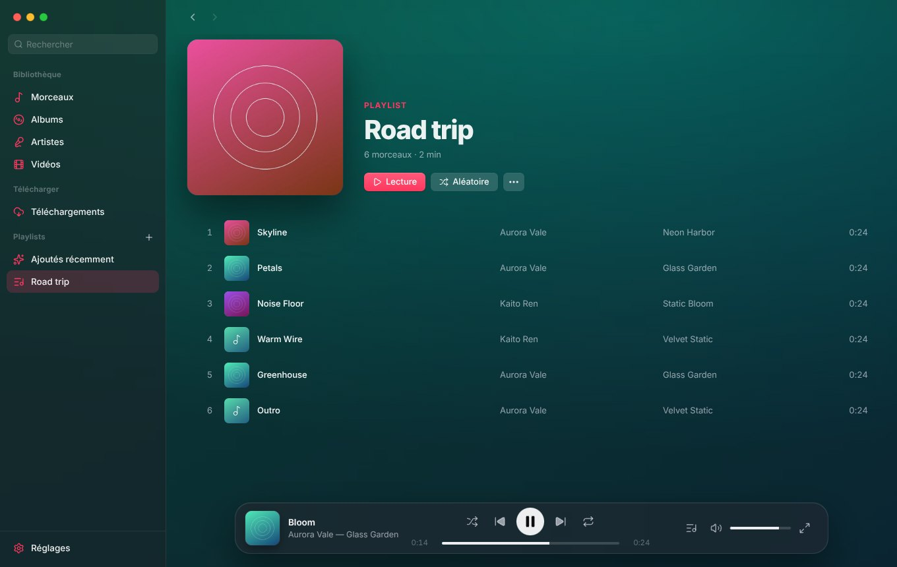
  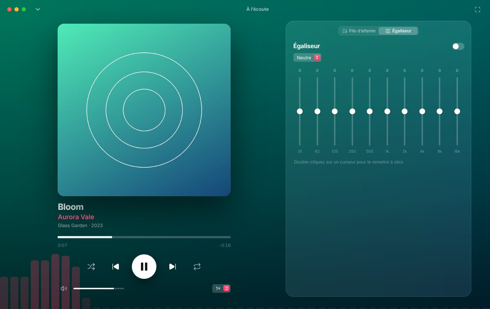
</p>

## Raccourcis clavier

| Touche | Action |
| --- | --- |
| `Espace` | Lecture / pause |
| `Ctrl` + `→` / `←` | Morceau suivant / précédent |
| `→` / `←` | Avancer / reculer de 10 s |
| `Ctrl` + `↑` / `↓` | Volume |
| `S` / `R` / `M` | Aléatoire / répéter / muet |
| `Q` / `E` / `L` | File d’attente / égaliseur / paroles |
| `Ctrl` + `I` | Modifier les tags de la sélection |
| `Entrée` | Ouvrir ou fermer « À l’écoute » |
| `F` | Plein écran (dans « À l’écoute ») |
| `Ctrl` + `F` ou `/` | Rechercher |
| `Alt` + `←` / `→` | Page précédente / suivante |
| `Ctrl` + `,` | Réglages |
| `Échap` | Fermer |

Dans une liste : `↑` `↓` pour se déplacer, `Maj` ou `Ctrl` pour sélectionner plusieurs morceaux, `Entrée` pour lire, `Suppr` pour retirer.

## Idées pour la suite

- Mini-lecteur flottant.

## Développer

Il faut Node.js 22 ou plus.

```bash
npm install
npm start            # lance l’appli en développement
npm run dist         # construit l’installateur et la version portable dans dist/
```

`npm run dist:portable` et `npm run dist:setup` construisent l’un ou l’autre ; `npm run dist:linux` construit l’AppImage et le paquet .deb (sous Linux). La version portable se construit aussi sous Linux ; l’installateur NSIS demande Windows (ou Wine). Le workflow GitHub Actions (`.github/workflows/build.yml`) construit sur `windows-latest` et sur `ubuntu-latest` à chaque push, dépose les fichiers en artefacts, et un dernier job publie une release avec les quatre quand la version de `package.json` n’a pas encore de release sur la branche par défaut (ou quand on pousse un tag `v*`).

### Organisation

```
src/main/           processus principal : fenêtre, protocole app://, SQLite, scan, yt-dlp
  db.js             schéma SQLite (module node:sqlite intégré, aucun module natif)
  library.js        scan incrémental, tags (music-metadata), pochettes, playlists, écoutes
  tools.js          téléchargement de yt-dlp, ffmpeg et deno au premier lancement
  downloads.js      file de téléchargements et analyse des liens
  tags.js           lecture et écriture des tags (node-taglib-sharp), pochettes, renommage, annulation
  stats.js          statistiques d’écoute et de visionnage (requêtes SQL à la demande)
  lyrics.js         paroles : .lrc voisin, tags du fichier, LRCLIB (avec nouvel essai), cache
  discord.js        Rich Presence : canal local de Discord, mises à jour limitées, recherche de pochette
  updater.js        mise à jour : release GitHub, téléchargement vérifié (SHA-256), installation
  media/            films, séries, animés : TMDB, AniList, cache, progression, ma liste
src/renderer/       interface (modules ES, sans framework ni bundler)
  js/player.js      moteur de lecture : file, égaliseur, MediaSession, comptage d’écoutes
  js/data.js        bibliothèque en mémoire, albums et artistes dérivés, playlists intelligentes
  js/ui/            liste virtualisée, barre de lecture, « À l’écoute », menus, feuilles, éditeur de tags, paroles, récap
  js/tags/          motifs façon mp3tag (%artist% - %title%), casse, remplacement
  js/lyrics/        lecture du format LRC
  js/theme/         ambiances, fonds animés (canvas), application du thème (OLED, arrondi, translucidité)
  js/discord/       description de la lecture en cours pour la Rich Presence
  js/update/        état de la mise à jour partagé entre notification, barre latérale et réglages
  js/views/         Morceaux, Albums, Artistes, Vidéos, Playlist, Recherche, Téléchargements,
                    Films & séries, Animés, fiche, lecture, Ma liste, Statistiques
  js/media/         accès aux catalogues, cartes et rangées, adresse du lecteur vidrift
build/              icônes de l’application
```

Le design (jetons de couleur, contrôles, menus, info-bulles) est repris de [nil cam](https://github.com/nildontsleep/nil_cam).

### À savoir

- Télécharger depuis YouTube enfreint ses conditions d’utilisation : à utiliser pour un usage personnel, à tes propres risques.
- control n’héberge ni ne stocke aucune vidéo de film, série ou animé : le lecteur [vidrift](https://vidrift.net) est affiché tel quel dans la fenêtre (publicités comprises), et c’est à toi de vérifier que son usage est légal chez toi. Si le lecteur ne charge pas, essaie l’autre serveur dans *Réglages* → *Streaming*.
- La clé TMDB reste dans les réglages de ton ordinateur. Ce produit utilise l’API TMDB mais n’est ni approuvé ni certifié par TMDB.
- Les captures d’écran du dépôt utilisent un catalogue fictif et une bibliothèque de test : aucune affiche ni pochette réelle n’y figure.
- L’éditeur de tags modifie tes fichiers sur place. Il garde de quoi annuler le dernier lot, mais fais une copie de ta musique avant un gros travail par lot.
- Les paroles sont cherchées avec le titre, l’artiste, l’album et la durée du morceau ; rien d’autre n’est envoyé. Les pochettes proposées dans l’éditeur de tags viennent des API publiques d’Apple Music et de Deezer.
- Discord : control parle au Discord installé sur l’ordinateur, sans compte ni jeton. Discord n’affiche que des images accessibles par une adresse publique : avec l’option *Pochettes*, la pochette du fichier (celle des tags, ou l’image d’une vidéo) est envoyée à un hébergeur temporaire sans compte ([litterbox.catbox.moe](https://litterbox.catbox.moe), sinon [uguu.se](https://uguu.se) ; effacée au bout de quelques heures) ; les affiches de films, séries et animés viennent directement de TMDB / AniList. Désactivée, ou sans pochette, c’est le logo de control qui s’affiche ; la ligne « Pochette : … » des réglages indique ce qu’il en est advenu.
- Mises à jour : le dépôt GitHub est interrogé pour connaître la dernière version, rien d’autre n’est envoyé. Si le dépôt est **privé**, GitHub refuse la requête sans identifiant : colle alors dans *Réglages* → *À propos* un jeton GitHub en lecture seule (*Contents : Read*), qui reste sur ton ordinateur — ou rends le dépôt public.
- Certains lecteurs vidéo vérifient qu’ils peuvent ouvrir une fenêtre : control en autorise une, invisible, vide et sans accès au reste de l’application, pour que le lecteur vidrift démarre.
- Les données (bibliothèque SQLite, réglages, pochettes, outils) sont dans `%APPDATA%\control` (installé), dans `control data` à côté de l’exe (portable) ou dans `~/.config/control` (Linux).

Icônes [Lucide](https://lucide.dev) et police [Inter](https://rsms.me/inter) : voir [THIRD-PARTY.md](THIRD-PARTY.md).
