<p align="center">
  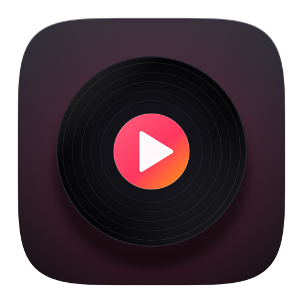
</p>

<h1 align="center">control</h1>

<p align="center">Lecteur musique et vidéo pour Windows, Linux et le web : téléchargements yt-dlp (YouTube, SoundCloud…), éditeur de tags, paroles synchronisées, statistiques d’écoute, films, séries et animés, Discord Rich Presence.<br>
Utilisable aussi **depuis un navigateur ou un téléphone**, hébergé chez toi (voir *Version web*).<br>
Un design façon macOS : verre dépoli, pochettes qui teintent la fenêtre, animations à ressort, et des ambiances en un clic.</p>

<p align="center">
  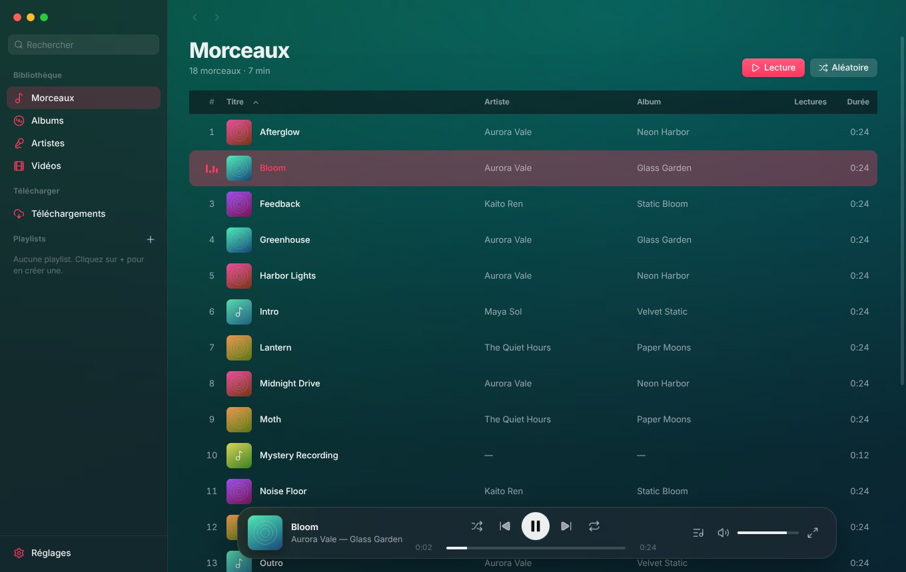
  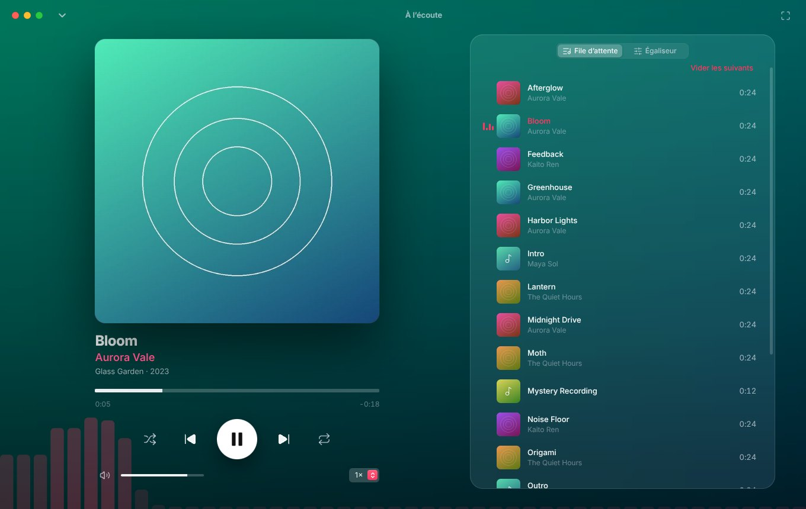
  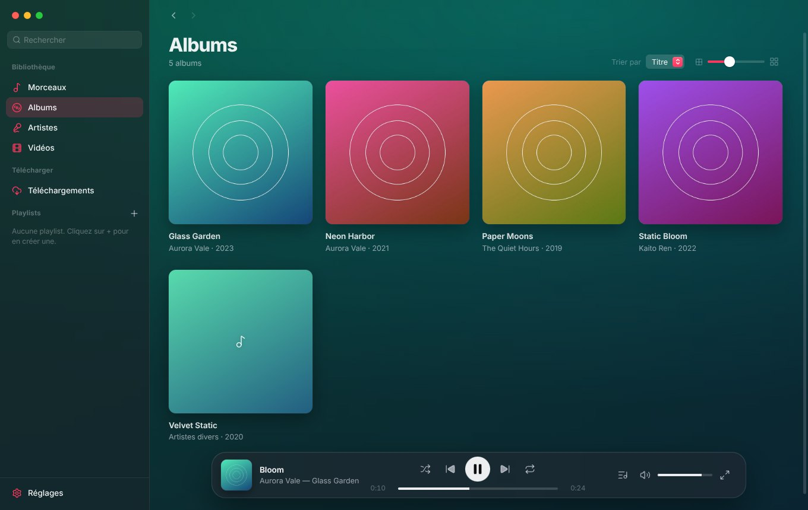
  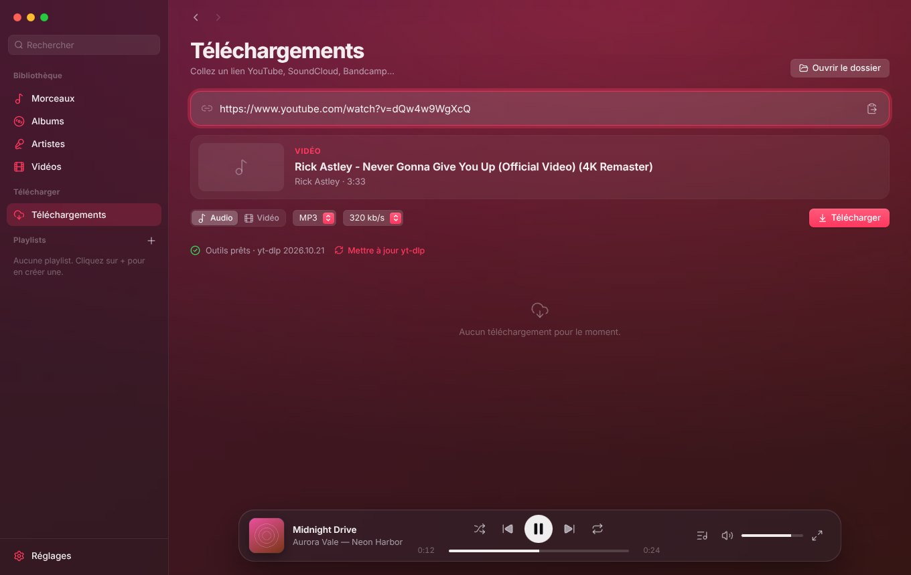
  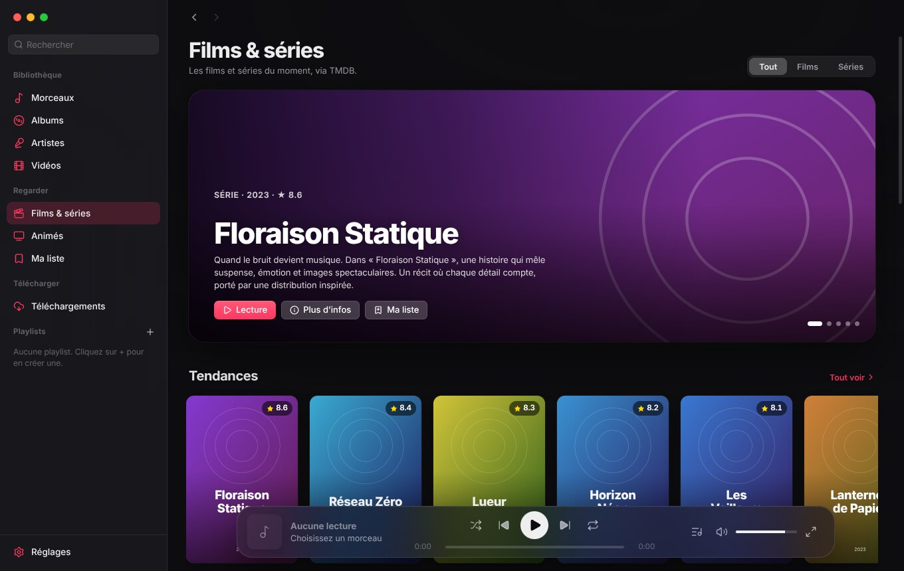
  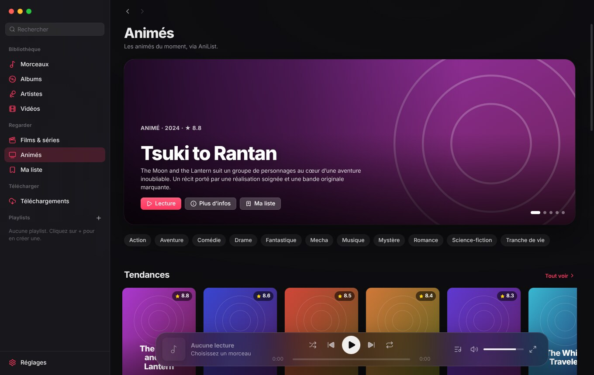
</p>

<sub>Captures réalisées avec une bibliothèque de test et un catalogue fictif générés pour l’occasion (les affiches sont des illustrations).</sub>

## Télécharger

Chaque build est produit par GitHub Actions et publié dans **Releases** :

| Fichier | Pour qui |
| --- | --- |
| `control-<version>-setup.exe` | **Installateur** : raccourcis Bureau et menu Démarrer, désinstallation depuis les Paramètres Windows. |
| `control-<version>-portable.exe` | **Portable** : un seul fichier. La bibliothèque, les réglages et les outils vont dans un dossier `control data` posé à côté. |

| `control-<version>-x86_64.AppImage` | **Linux, un seul fichier** : `chmod +x control-*.AppImage` puis double-clic ou `./control-*.AppImage`. Se met à jour tout seul depuis l’application. |
| `control-<version>-amd64.deb` | **Linux (Debian, Ubuntu et dérivés)** : `sudo apt install ./control-*.deb`. Une nouvelle version est signalée dans l’application ; le paquet se télécharge à la main. |

L’exécutable Windows n’est pas signé : au premier lancement, SmartScreen peut afficher « Windows a protégé votre ordinateur ». Clique sur **Informations complémentaires** → **Exécuter quand même**.

**Linux** : 64 bits (x86_64) uniquement. L’AppImage demande FUSE 2 sur Ubuntu 22.04 et plus récent (`sudo apt install libfuse2t64`, ou `libfuse2` avant 24.04) ; sans FUSE : `./control-*.AppImage --appimage-extract-and-run`. Sur les distributions qui interdisent l’espace utilisateur isolé (Ubuntu 24.04…), l’AppImage ne peut pas installer le bac à sable de Chromium et démarre sans lui ; le paquet .deb, lui, installe ce qu’il faut. Les outils de téléchargement (yt-dlp, ffmpeg, deno) sont téléchargés au premier besoin ; l’extraction demande `tar` et `unzip` (`sudo apt install unzip xz-utils`), et un ffmpeg déjà installé sur le système est utilisé tel quel. Les touches multimédia et le panneau du bureau passent par MPRIS (non vérifié sur toutes les distributions).

## Premiers pas

1. **Ajoute ta musique** : bouton *Ajouter mon dossier Musique* au premier lancement, ou glisse des fichiers et des dossiers dans la fenêtre. Les dossiers ajoutés sont surveillés : un nouveau fichier apparaît tout seul au bout de quelques secondes.
2. **Télécharge** (facultatif) : onglet *Téléchargements* → *Installer* (yt-dlp, ffmpeg et deno sont téléchargés une seule fois), puis colle un lien.
3. **Écoute** : double-clic sur un morceau, ou `Espace`.
4. **Regarde** (facultatif) : les *Animés* fonctionnent tout de suite. Pour les *Films & séries*, colle une clé TMDB gratuite (carte au premier affichage, ou *Réglages* → *Streaming*, voir plus bas).

## Ce qu’il y a dedans

**Lecteur**
- Audio (MP3, FLAC, M4A, AAC, OGG, Opus, WAV) et vidéo (MP4, MKV, WebM, MOV) dans la même app.
- File d’attente modifiable par glisser-déposer, aléatoire, répétition (tout / un seul), vitesse de lecture.
- **Égaliseur 10 bandes** avec 10 préréglages.
- **Fondu enchaîné** réglable de 1 à 12 s (*Réglages* → *Général*) : la fin d’un morceau se mêle au début du suivant, à puissance constante.
- **AutoMix** (bouton à côté d’aléatoire et répéter, ou touche `A`) : à la manière d’Apple Music, les morceaux s’enchaînent comme un DJ le ferait. Chaque morceau est analysé en arrière-plan (tempo et grille de temps, résultat gardé en cache) ; le suivant est ajusté au tempo du morceau en cours (sans changer la hauteur), entre sur un temps, puis les deux sont fondus sur 8 à 16 temps avec un échange des basses. Un asservissement garde les deux sur le même temps pendant tout l’enchaînement. Quand les tempos sont trop éloignés ou non détectables (classique, ambiances…), AutoMix se rabat sur un fondu simple, calé sur la fin audible du morceau (sans le silence final).
- **Paroles synchronisées** : onglet *Paroles* de « À l’écoute » (`L`). Les lignes défilent avec la musique, un clic sur une ligne s’y rend. Elles viennent d’un fichier `.lrc` posé à côté du morceau, des paroles intégrées au fichier, ou de [LRCLIB](https://lrclib.net) (gratuit, sans compte) ; une fois trouvées, elles sont gardées. On peut aussi en coller, ou les enregistrer en `.lrc`.
- **Mode immersif** (bouton ✨ en haut de « À l’écoute », ou touche `I`) : plein écran, sans aucun contrôle, rien que la pochette et les paroles. Les paroles défilent avec une animation façon Apple Music (ligne courante en grand, mots qui s’allument au rythme du chant, les autres floues et en retrait, interludes en trois points) ; elles se masquent d’un coup de `L` et disparaissent toutes seules quand il n’y en a pas, la pochette passant alors au centre. Le fond suit le thème (clair, sombre, OLED, ambiance animée) mais prend les couleurs de la pochette, qui changent en douceur d’un morceau à l’autre. Un clic sur la pochette lance ou met en pause ; une barre discrète (paroles, quitter) n’apparaît que quand la souris bouge. `Échap` pour en sortir.
- Touches multimédia du clavier et panneau multimédia de Windows (pochette, titre, position).
- Reprise de la session au lancement (file d’attente, morceau, position).
- Écran **À l’écoute** plein fenêtre sur fond de pochette floutée ; la vidéo y passe en grand, avec une interface qui se masque d’elle-même.
- **Vraie barre de contrôle pour les vidéos** : barre de progression, ±10 s, précédent / suivant, volume, vitesse, image dans l’image et **plein écran** (`F`, `Échap` pour en sortir).

**Bibliothèque**
- **Artistes séparés** : une étiquette « A, B feat. C » (virgules, « ， », « ; », feat./ft.) donne une fiche par artiste, sans doublon ni pseudo `@…` ; un morceau apparaît chez chacun de ses artistes, et la liste des morceaux n’affiche plus l’étiquette en double. Le menu d’un morceau propose « Aller à l’artiste » pour chacun.
- Analyse incrémentale (rescan quasi instantané), tags et pochettes lus dans les fichiers, ou `cover.jpg` / `folder.jpg` du dossier.
- Vues *Morceaux* (liste virtualisée, tri par colonne), *Albums* (taille réglable), *Artistes*, *Vidéos*.
- Recherche instantanée dans les morceaux, albums, artistes, vidéos et playlists.
- Menu contextuel partout : lire, lire ensuite, ajouter à la file ou à une playlist, aller à l’artiste, afficher dans le dossier, supprimer (avec corbeille en option).

**Éditeur de tags** (clic droit → *Modifier les tags…*, ou `Ctrl` + `I`)
- Un ou plusieurs morceaux à la fois : titre, artiste, artiste de l’album, album, genre, année, piste et disque, compositeur, commentaire, paroles. Les champs qui diffèrent d’un morceau à l’autre affichent « Plusieurs valeurs » et ne sont touchés que si tu les modifies ; on peut aussi passer d’un morceau à l’autre dans la sélection.
- **Pochette** : choisir une image, la glisser sur la pochette, la retirer, ou **la chercher en ligne** (Apple Music et Deezer).
- **Outils par lot**, avec aperçu avant d’appliquer : *tags depuis le nom du fichier* (`%artist% - %title%`…), *renommer les fichiers depuis les tags*, *numéroter les pistes*, *remplacer* (texte ou expression régulière), *casse*, *nettoyer* (« (Official Video) », espaces en trop).
- MP3, FLAC, M4A, OGG, Opus, WAV : les tags sont écrits dans le fichier, sans le réencoder. Rien n’est écrit tant que tu n’as pas cliqué sur *Enregistrer*, et le dernier lot peut être **annulé**. Les lectures et les playlists suivent un fichier renommé.

**Statistiques** (barre latérale → *Statistiques*)
- Temps d’écoute, lectures, morceaux et artistes différents, série de jours d’écoute, sur 7 jours, 30 jours, l’année ou tout l’historique.
- Histogramme des jours, calendrier de l’année, heures et jours de la semaine préférés, tops des morceaux, artistes, albums et genres (un clic lance la lecture ou ouvre la page).
- Films, séries et animés : temps de visionnage, titres les plus regardés, genres.
- **Récap** façon « Wrapped » : une suite de cartes plein écran, avec une image à enregistrer pour la partager. Un par **année, mois, semaine ou jour** (menu *Récap* de la page ; dans la fenêtre, les boutons *Année / Mois / Semaine / Jour* et les flèches passent d’une période d’activité à l’autre). Une notification propose le récap du mois écoulé en début de mois, et celui de la semaine écoulée en début de semaine.

<p align="center">
  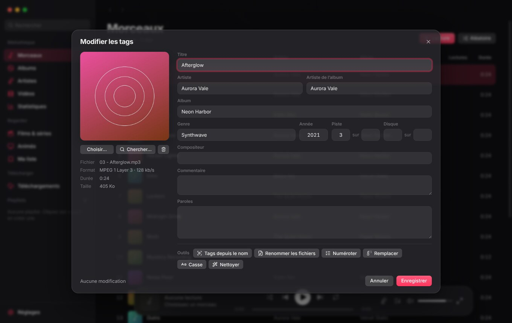
  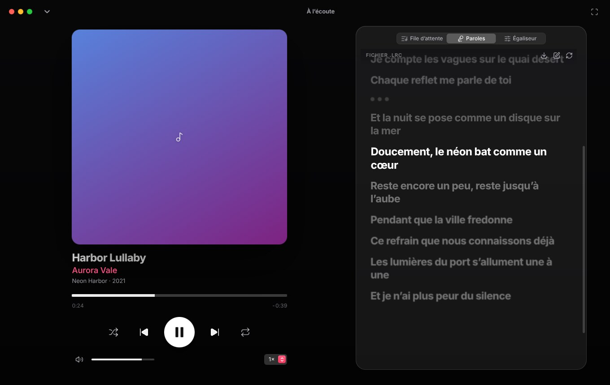
  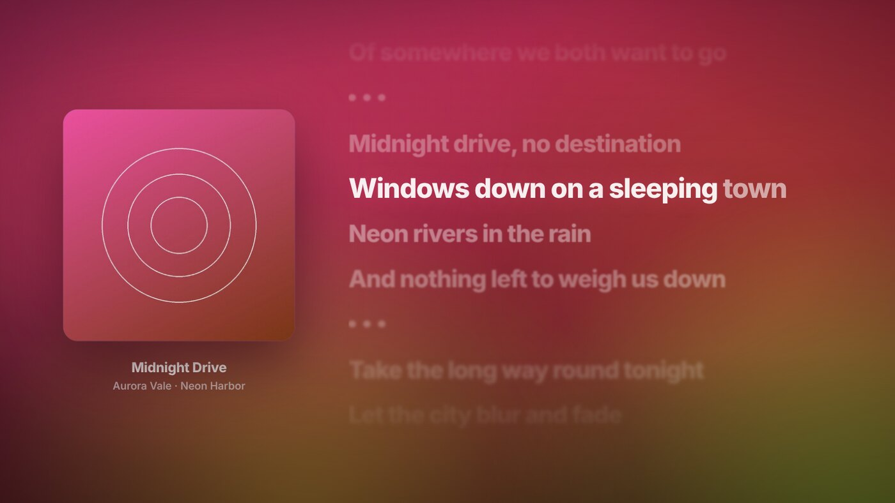
  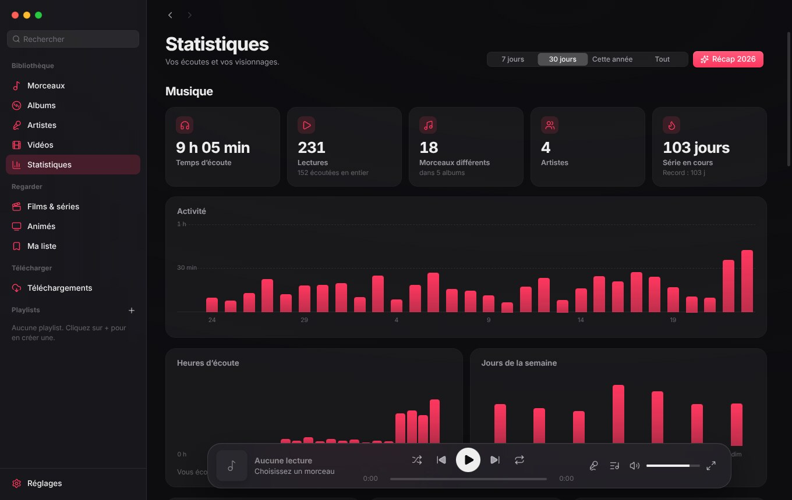
  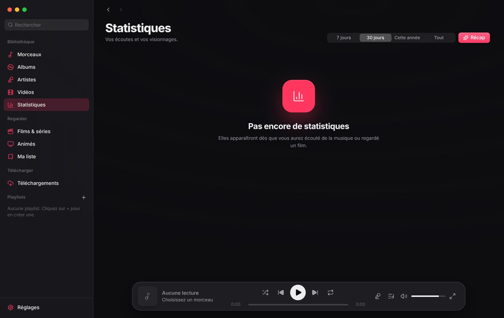
</p>

**Playlists**
- Classiques : glisser des morceaux depuis n’importe quelle vue, réordonner par glisser-déposer.
- **Intelligentes** : règles combinables (lectures, dernière écoute, date d’ajout, genre, artiste, album, année, durée), tri, limite, aperçu du nombre de résultats. Modèles prêts à l’emploi : les plus écoutés, ajoutés récemment, jamais écoutés, écoutés récemment.
- Import et export M3U / M3U8.

**Téléchargements (yt-dlp)**
- Colle un lien YouTube, SoundCloud, Bandcamp… (vidéo, morceau, playlist ou « set ») : l’appli l’analyse et affiche titre, durée et vignette.
- **Recherche sans lien** : tape un titre ou un artiste, choisis *SoundCloud* ou *YouTube*, et télécharge directement un résultat.
- Audio MP3 (128–320 kb/s), M4A, Opus, FLAC ou original ; vidéo MP4 de 480p jusqu’à la 4K.
- Titre, artiste et pochette intégrés au fichier ; « Artiste - Titre » découpé automatiquement, et les « (Official Video) », « [Lyrics] » retirés du titre.
- File avec progression, vitesse, temps restant, annulation et nouvel essai ; les playlists créent une playlist dans l’appli.
- **Mise à jour automatique de yt-dlp** une fois par jour (YouTube casse régulièrement les anciennes versions).
- *Cookies du navigateur* en option, pour les vidéos qui demandent de se connecter ou de prouver qu’on n’est pas un robot. Firefox marche le mieux ; Chrome, Edge et Brave chiffrent leurs cookies sous Windows (« Could not copy Chrome cookie database ») : on peut alors choisir un **fichier `cookies.txt`** exporté du navigateur (extension « Get cookies.txt LOCALLY »), qui passe avant le réglage du navigateur.

**Films, séries et animés**
- Accueil *Films & séries* (tendances, au cinéma, populaires, les mieux notés, séries en cours de diffusion, genres) et accueil *Animés* (tendances, saison en cours, populaires, films), avec un bandeau de mise en avant, des rangées à défilement et « Tout voir ».
- Fiches détaillées : synopsis, note, genres, distribution, bande-annonce, liste des saisons et des épisodes, titres liés ou recommandés, date du prochain épisode pour les animés.
- Lecture dans l’appli avec [vidrift](https://vidrift.net) (lecteur intégré, plein écran géré par la fenêtre) : **reprise automatique** là où tu t’es arrêté, épisode précédent / suivant, doublage anglais en option pour les animés.
- **Continuer à regarder**, historique, **Ma liste**, et recherche en ligne dans la barre de gauche (elle cherche aussi bien dans ta bibliothèque que dans les catalogues).
- Métadonnées : [TMDB](https://www.themoviedb.org) pour les films et séries (clé gratuite à coller dans les réglages), [AniList](https://anilist.co) pour les animés (aucune clé). Les catalogues sont mis en cache et restent consultables quelques heures sans réseau.

**Apparence** (*Réglages* → *Apparence*)
- Par défaut, control garde son look d’origine (verre dépoli, pochettes qui teintent la fenêtre). Les ambiances sont là si tu veux autre chose.
- **12 ambiances** en un clic : *control* (l’apparence d’origine), Ember, Midnight, Forêt, Ocean, Iris, Sakura, Gold, Blood Moon, Snowfall, Cyberpunk, Monochrome. Tu peux **enregistrer la tienne** à partir de l’apparence actuelle, et revenir à *control* d’un clic.
- Thème clair, sombre, automatique ou **OLED** (noir profond, profondeur réglable), 8 couleurs d’accentuation macOS et une couleur libre.
- **16 fonds animés** (braises, étoiles, lucioles, ondes, nébuleuse, pluie, plasma, météores, neige, hyperespace, grille, bulles, constellation, brume, aurore) : vitesse et flou réglables ; ils se mettent en pause quand la fenêtre est inactive ou que les animations sont coupées.
- Arrondi des coins, translucidité et taille de l’interface réglables ; listes compactes ; animations désactivables.
- Interface en français ou en anglais.

<p align="center">
  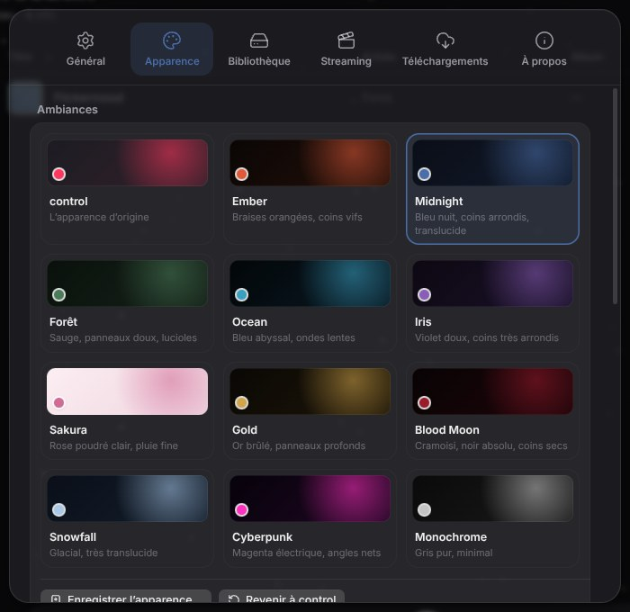
</p>

**Discord Rich Presence** (*Réglages* → *Général* → *Discord*)
- Affiche sur ton profil « Écoute control » (titre, artiste, **pochette du fichier**, barre de progression) ou « Regarde control » (vidéo, film, série, épisode, affiche), avec une pastille lecture / pause.
- Activable séparément pour la musique, les vidéos et le streaming ; option **Masquer les titres** pour ne montrer que « Écoute de la musique ». Une pause de plus de 10 minutes efface la présence.
- Demande l’application Discord de bureau ouverte. Mise en place de l’application Discord et des images : [docs/discord-assets](docs/discord-assets/README.md).

**Mises à jour** (*Réglages* → *À propos*)
- control cherche tout seul une nouvelle version (au lancement puis toutes les 6 h) et le dit par une notification et une pastille sur *Réglages*. Un clic sur *Mettre à jour et redémarrer* télécharge la version, **vérifie son empreinte SHA-256**, l’installe et relance l’application — installateur ou portable, selon l’édition en cours.

<p align="center">
  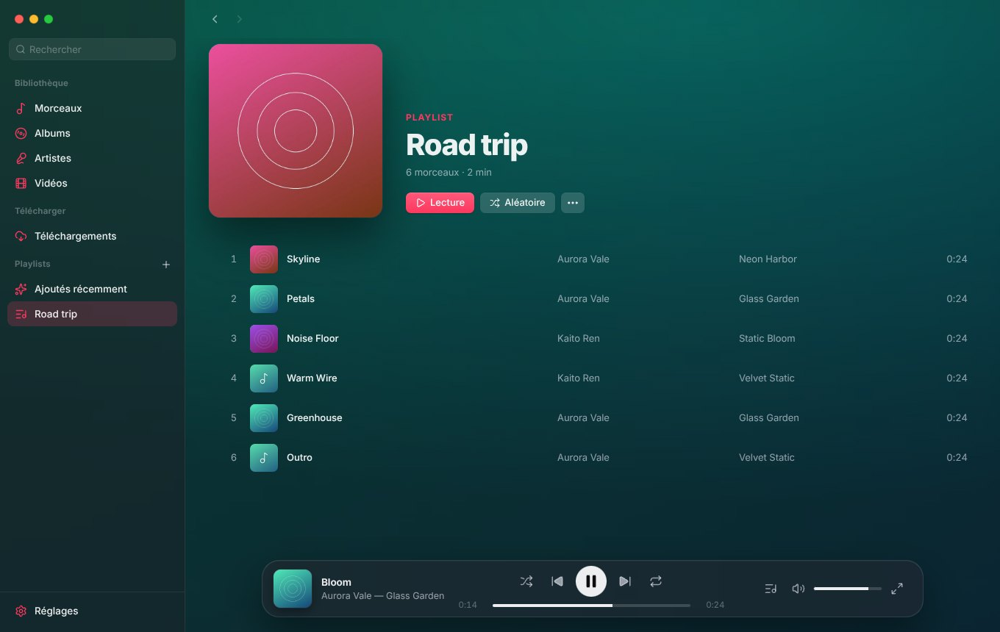
  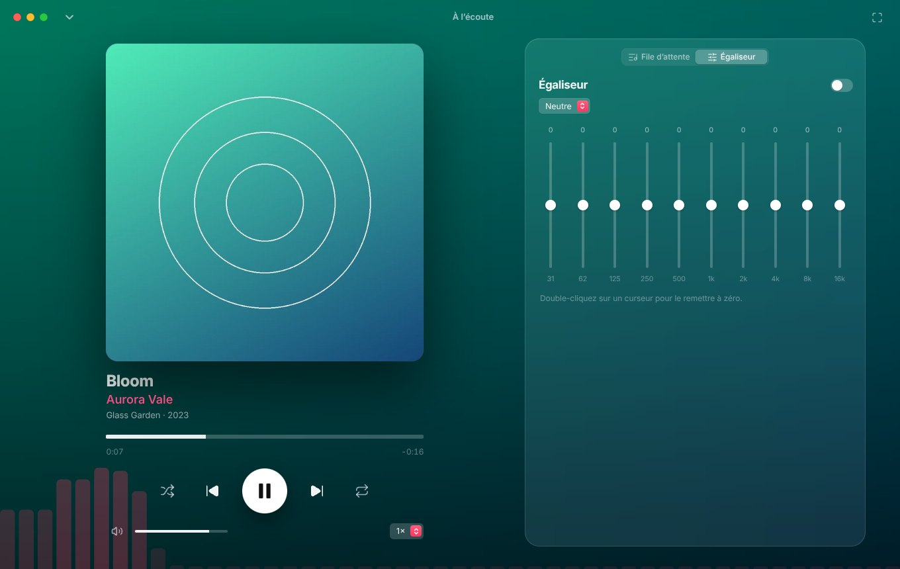
</p>

## Version web

Le même control, hébergé sur un serveur (ton PC, un NAS, un Raspberry Pi, un VPS) et utilisable depuis **n’importe quel navigateur, téléphone compris** : la musique reste chez toi, l’interface (lecteur, AutoMix, paroles, mode immersif, statistiques, récaps, playlists, films et séries) est la même. Sur un téléphone, la barre latérale devient un tiroir, la barre de lecture se compacte, et l’application peut être **installée sur l’écran d’accueil** (PWA), avec lecture **écran éteint**, image dans l’image et écran verrouillé (voir *Sur téléphone et tablette*).

**Comptes, à la manière de [vie](https://github.com/nildontsleep/vie)** : au premier lancement, un assistant crée le compte *administrateur* (nom du serveur, dossier de musique, mot de passe). Ensuite on se connecte (cookie de session `HttpOnly`, mots de passe hachés avec scrypt, essais limités). L’administrateur crée des comptes ou ouvre les inscriptions depuis `/admin` ; chaque compte a **sa propre bibliothèque** : ses dossiers de musique, ses téléchargements, ses réglages, ses statistiques, ses récaps, ses playlists, ses films et séries vus. Chacun peut **personnaliser son profil et ses playlists**, **parcourir la bibliothèque des autres** selon ce qu’ils partagent, et **comparer ses récaps** avec les leurs (voir *Bibliothèques, partage et profils*).

### Lancer

```bash
npm ci --omit=dev       # Node.js 22.13 ou plus
CONTROL_LIBRARY=/chemin/vers/ma/musique npm run web
# puis ouvrir http://localhost:5180
```

`npm run web` passe par le lanceur (mise à jour automatique, voir plus bas) ; `npm run web:direct` lance le serveur seul.

Avec Docker (image `ghcr.io/nildontsleep/control`, ou `docker compose up -d` après avoir adapté `docker-compose.yml`) :

```bash
docker run -d --name control -p 5180:5180 \
  -e CONTROL_SETUP_TOKEN=un-code-secret \
  -v ./data:/data -v /chemin/vers/ma/musique:/music:ro \
  ghcr.io/nildontsleep/control:latest
```

### Configuration (variables d’environnement)

| Variable | Rôle |
| --- | --- |
| `PORT` (ou `CONTROL_PORT`) / `CONTROL_HOST` | Port (5180) et adresse d’écoute (0.0.0.0). |
| `CONTROL_DATA` | Dossier des données du serveur : comptes, réglages, bibliothèques, pochettes, outils (`./data`, `/data` dans Docker). |
| `CONTROL_LIBRARY` | Dossiers de musique proposés dans l’assistant du premier lancement (séparés par `:`, ou `;` sous Windows) : ils deviennent **ceux de l’administrateur**. Les autres comptes reçoivent les leurs depuis `/admin` (voir plus bas). |
| `CONTROL_SETUP_TOKEN` | Si défini, le premier compte ne peut être créé qu’avec ce code : **à définir dès que le serveur est joignable depuis Internet**. |
| `CONTROL_TRUST_PROXY` | `1` derrière un reverse proxy (nginx, Caddy, Traefik) : adresse réelle du client et cookie `Secure` en HTTPS. |
| `CONTROL_TMDB_KEY` | Clé TMDB offerte à tous les comptes (films et séries) ; chacun peut aussi mettre la sienne. |
| `CONTROL_SESSION_DAYS`, `CONTROL_RESCAN_MINUTES` | Durée d’une session (30 jours) ; période de la réanalyse complète des dossiers (30 min, en plus de la surveillance des fichiers). |
| `CONTROL_UPDATE` | `off`, `notify` ou `auto` : impose le mode de mise à jour du serveur (sinon l’administrateur le choisit dans `/admin`, *Prévenir seulement* par défaut). `off` convient si tu mets à jour l’image toi-même (Watchtower…). |
| `CONTROL_MAX_MEMORY` | Plafond du tas de Node, en Mo (par exemple `1024`) : il nettoie davantage au lieu de laisser le système tuer le processus. Voir *Mémoire* plus bas. |
| `CONTROL_UPDATE_TOKEN` | Jeton GitHub en lecture, seulement si le dépôt des releases est privé (il peut aussi se saisir dans `/admin`). |

### YouTube bloque les téléchargements (« confirmer que vous n’êtes pas un robot »)

Sur un serveur, YouTube demande souvent une connexion. Le serveur ne peut pas lire les cookies de ton navigateur : *Réglages* → *Téléchargements* → *Fichier cookies.txt* → **Envoyer…**. Exporte d’abord le fichier toi-même : connecte-toi à YouTube (idéalement dans une fenêtre privée), utilise l’extension « Get cookies.txt LOCALLY », puis ferme la fenêtre privée (sinon YouTube renouvelle les cookies et le fichier cesse de marcher). Le fichier est vérifié (format Netscape), gardé sur le serveur **pour ton compte seulement** (lisible par le serveur seul) et ne sert qu’à yt-dlp ; il n’est jamais renvoyé au navigateur. Préfère un compte YouTube secondaire : YouTube peut restreindre un compte utilisé par un outil automatique, et il n’est pas certain qu’un fichier de cookies suffise à lever tous les blocages d’une adresse de serveur.

### Mises à jour du serveur

Le serveur sait **se mettre à jour tout seul** à partir des releases GitHub, sans toucher à Docker ni à un terminal. `npm run web` et l’image Docker lancent un petit **lanceur** (`server/launcher.js`) qui fait tourner le serveur ; la mise à jour passe par lui :

1. toutes les 6 heures (et au lancement), le serveur cherche une release plus récente ;
2. il télécharge l’archive du serveur jointe à la release (`control-web-<version>.tgz`, environ 700 Ko), **vérifie son empreinte SHA-256**, puis l’installe dans `<données>/app/versions/<version>` à côté de la version en cours (une copie de `server.db` est faite avant) ;
3. il demande au lanceur de redémarrer le serveur sur cette version (quelques secondes de coupure : les pages se reconnectent toutes seules, et celle de l’administrateur se recharge) ;
4. **si la nouvelle version ne démarre pas**, le lanceur revient seul à la précédente, ne la réessaie plus et l’administrateur en est informé.

Dans `/admin` → *Mises à jour du serveur* (et dans *Réglages* → *À propos* pour un administrateur, avec une pastille quand une version est disponible), trois modes :

- **Prévenir seulement** (par défaut) : on vérifie et on signale ; l’installation se fait d’un clic (*Mettre à jour et redémarrer*) ;
- **Automatiques** : téléchargement automatique, puis installation dès que plus personne n’est connecté, ou à l’heure choisie au plus tard (4 h par défaut) ;
- **Désactivées** : aucune vérification (le bouton *Rechercher* reste là).

À savoir :

- Seul le code de l’application change. Les dépendances de l’installation d’origine servent tant qu’elles ne changent pas ; si une version en change, le serveur lance `npm ci` pour elle (réseau et npm requis), et renonce proprement s’il échoue.
- Une image Docker plus récente que la version téléchargée reprend la main (la version téléchargée est oubliée) : les deux voies se combinent.
- Sans lanceur (`npm run web:direct`, ou `node server/index.js`), le serveur signale les nouvelles versions mais ne peut pas se redémarrer lui-même.
- **Un serveur en 0.8.x ne peut pas encore se mettre à jour tout seul** : passe une fois à cette version (`docker pull`, ou `git pull` et `npm ci`), ensuite les suivantes sont automatiques.
- Sécurité : seules les releases de ce dépôt sont acceptées, l’archive doit correspondre à l’empreinte calculée par GitHub, son contenu est lu strictement (ni lien, ni chemin hors du dossier d’installation, taille limitée), et le jeton GitHub éventuel ne quitte jamais le serveur.

### Adresses des vues

Chaque vue a son adresse (`/#/album/…`, `#/artist/…`, `#/playlist/12`, `#/stats`…) : on peut la partager, la mettre en favori ou recharger la page sans perdre sa place, et le bouton retour du navigateur (ou le geste retour d’un téléphone) revient à la vue précédente au lieu de quitter l’application. L’adresse d’un album est un identifiant court, sans le chemin du dossier sur le serveur.

### Sur téléphone et tablette (iPhone, iPad, Android)

Ouvre l’adresse du serveur, puis **installe l’application** : sur iPhone et iPad, Safari → *Partager* → *Sur l’écran d’accueil* ; sur Android, Chrome → *Installer l’application*. Elle s’ouvre alors en plein écran, sans barre d’adresse, avec sa propre icône.

- **Écran éteint** : la musique continue quand l’écran s’éteint ou dans une autre appli, morceau suivant compris. L’écran verrouillé et la notification Android affichent la pochette, avec précédent / suivant (et ±10 s pour les vidéos). Pour y arriver, le téléphone lit les fichiers directement, sans passer par Web Audio : l’**égaliseur**, le **fondu enchaîné** et **AutoMix** y sont donc coupés par défaut, car iOS interromprait la lecture écran éteint. *Réglages* → *Général* → *Lecture écran éteint* les réactive, en renonçant à la lecture écran éteint.
- **Vidéos** : quand l’écran s’éteint pendant une vidéo, son **son continue** et l’image revient à la même position au retour (*Son des vidéos écran éteint*, activé par défaut). Avec l’**image dans l’image** (bouton dans la barre de la vidéo, ou automatiquement en quittant l’appli depuis le plein écran sur iPhone), la vidéo continue à l’écran par-dessus les autres applis. Sur iPhone, le bouton plein écran ouvre le lecteur vidéo du système (rotation, image dans l’image, AirPlay) ; sur Android, la vidéo passe en paysage. Les films et séries (lecteur vidrift) ont aussi leur plein écran sur iPhone.
- **Diffusion** : un bouton AirPlay (iPhone, iPad) ou Chromecast (Android) apparaît dans « À l’écoute » quand un appareil est à portée.
- **Au doigt** : boutons et lignes de menu à la taille du pouce, menus en feuille d’actions et réglages en feuille qui monte du bas (à refermer en la tirant vers le bas), « À l’écoute » qui se referme en glissant vers le bas, appui long pour le menu d’un morceau, encoche et barre d’accueil respectées en portrait comme en paysage, clavier qui ne masque plus les champs. Le **bouton retour d’Android** ferme ce qui est ouvert (menu, feuille, « À l’écoute », tiroir) puis revient à la page précédente avant de quitter l’appli.
- **Limites** : sur iPhone, le volume se règle avec les boutons de l’appareil (le curseur n’y est pas proposé) et la normalisation du volume ne peut qu’atténuer quand Web Audio est coupé. Une vidéo que le navigateur ne sait pas lire (MKV, codecs exotiques) ne se lit pas non plus sur le téléphone.

### Envoyer de la musique depuis le navigateur

Glisse des fichiers ou des dossiers dans la fenêtre, ou *Réglages* → *Bibliothèque* → *Envoyer des fichiers…* / *Envoyer un dossier…* (également dans l’écran d’une bibliothèque vide). Les fichiers arrivent en flux dans `<téléchargements>/<ton nom>/Envois` (les sous-dossiers d’un dossier envoyé sont conservés), entrent aussitôt dans ta bibliothèque et ne remplacent jamais un fichier existant (`titre (2).mp3`). Seuls les vrais fichiers audio et vidéo sont gardés : le contenu est vérifié, le nom nettoyé, la taille limitée (500 Mo par défaut) et le serveur garde de la place libre sur son disque. Réservé à l’administrateur tant que `/admin` → *Envois de musique pour tous* n’est pas coché.

### Normalisation du volume

*Réglages* → *Général* → *Lecture* → *Normaliser le volume* : tous les morceaux sonnent au même niveau (−16 LUFS par défaut, ou −18 / −14). Le niveau de chaque morceau est mesuré en arrière-plan par ffmpeg (norme EBU R128, un morceau à la fois, seulement tant que l’option est active : compte quelques secondes par morceau) ; le lecteur applique ensuite un gain par morceau, sans écrêtage (la relève s’arrête 1 dB avant la crête), y compris pendant les fondus et AutoMix. Sur téléphone, où le graphe Web Audio est évité, seule l’atténuation s’applique.

### Voir ce que les autres écoutent

*Mon profil* → *Partage* : *Montrer ce que j’écoute* (désactivé par défaut). Les comptes avec lesquels tu partages ta bibliothèque (ou tout le monde, si tu l’as choisi) voient alors, sur la page *Personnes* et sur ton profil, le morceau en cours, en direct, avec un bouton *Écouter ce morceau* qui ouvre ta bibliothèque et le lance. L’administrateur n’y a droit que s’il a un partage comme les autres. Rien n’est gardé sur le disque : l’information disparaît à la fin du morceau ou si l’option est coupée.

### Scrobbling (Last.fm, ListenBrainz)

*Réglages* → *Général* → *Scrobbling* (application de bureau et web). Chaque compte peut envoyer ses écoutes à **ListenBrainz** (colle ton jeton, `listenbrainz.org/settings`) et/ou à **Last.fm** (autorisation sur leur site, sans jamais confier ton mot de passe à control). Un morceau est annoncé « en écoute » à son début, puis compte comme une écoute quand il dure au moins 30 s et que la moitié (ou 4 minutes) a été écoutée ; les vidéos et les morceaux sans artiste sont ignorés. Si le réseau est coupé, les écoutes attendent dans une file (14 jours au plus, 500 écoutes) et partent dès que possible. Les jetons sont gardés dans un fichier à part (`scrobble.json`), pas dans les réglages et pas dans les sauvegardes.

- **Last.fm** demande une application (gratuite) : sur le web, l’administrateur la crée sur `last.fm/api/account/create` et renseigne sa clé d’API et son secret dans `/admin` → *Last.fm* ; sur le bureau, saisis les tiens à la première connexion.
- Une adresse ListenBrainz personnalisée (serveur auto-hébergé) n’est acceptée que si elle est publique.

### Applications Subsonic / OpenSubsonic

Le serveur parle l’API **Subsonic 1.16.1** (avec les extensions OpenSubsonic courantes) sur `/rest/…` : tu peux donc écouter ta bibliothèque depuis Symfonium, DSub, Feishin, Amperfy, Sonixd, Substreamer, Tempo… *Mon profil* → *Applications compatibles Subsonic* donne l’adresse du serveur, ton identifiant et un **mot de passe d’application** (à confirmer avec le mot de passe du compte, renouvelable et révocable à tout moment). Ce mot de passe ne sert qu’à l’API : il ne donne jamais accès au site, et ta session ou ton mot de passe réel ne transitent jamais par une application tierce. Les clients utilisent l’authentification par jeton (`u` + `t` + `s`), par mot de passe (`p`, y compris `enc:`) ou par clé d’API OpenSubsonic (`apiKey`) ; réponses en XML, JSON ou JSONP. L’administrateur peut tout couper dans `/admin` → *API Subsonic*. Les tentatives ratées sont limitées.

- **Géré** : artistes, albums, morceaux, genres, dossiers, recherche (`search2` / `search3`), listes d’albums (aléatoire, récents, fréquents, par année ou genre, alphabétiques), morceaux aléatoires, playlists (création, modification, suppression), flux avec `Range` (lecture et déplacement dans le morceau), téléchargement, pochettes (taille demandée), paroles, favoris, « en écoute », comptage des écoutes (qui alimente tes statistiques et ton scrobbling Last.fm / ListenBrainz).
- **Favoris** : le « ♥ » des applications range les morceaux dans une playlist manuelle nommée **Favoris**.
- **Seulement ta bibliothèque** : un identifiant qui n’en fait pas partie est refusé, jamais servi.
- **Une application dit « identifiants incorrects »** : `/admin` → *Connexions Subsonic* donne la raison exacte de chaque tentative (compte introuvable, pas encore de mot de passe d’application, mauvais jeton, mot de passe du *compte* saisi à la place de celui de l’application…). Derrière un proxy, pense à `CONTROL_TRUST_PROXY=1` pour que le limiteur d’essais compte par adresse réelle et non par adresse du proxy.
- **Pas géré** : transcodage (les fichiers sont servis tels quels, ce qui suffit à la plupart des applications), podcasts, radios, partages, signets, jukebox, gestion d’utilisateurs. Ces appels répondent proprement (listes vides ou refus), sans faire échouer le client.

### Sauvegardes (webhook Discord)

`/admin` → *Sauvegardes* : colle l’adresse d’un **webhook Discord** (Paramètres du salon → Intégrations → Webhooks), choisis la fréquence (chaque jour ou chaque semaine, à partir de l’heure voulue) et, de préférence, une **phrase secrète**. Le serveur archive alors la base des comptes (`server.db`) et, pour chaque compte, sa base (écoutes, playlists, tags, progression, récaps) et ses réglages, chiffre l’archive (AES-256-GCM) si une phrase est définie, la découpe en parties de 9 Mo au plus et les poste dans le salon. Les deux dernières sauvegardes restent aussi dans `<données>/backups/`. Boutons *Sauvegarder maintenant* et *Tester le webhook*.

- **Jamais copiés** : les sessions ouvertes, les jetons et clés (GitHub, TMDB, webhook, phrase secrète, Last.fm, ListenBrainz) et les cookies YouTube.
- Sans phrase secrète, l’archive contient les **empreintes des mots de passe** (scrypt) : réserve-la à un salon privé.
- Les bibliothèques musicales elles-mêmes (les fichiers) ne sont pas dans la sauvegarde : seulement ce qui ne se reconstruit pas en rescannant.

Restauration : recolle les parties (`cat control-backup-*.part* > control-backup.tgz.enc`), déchiffre (`CONTROL_BACKUP_PASSPHRASE=… node server/backup.js decrypt control-backup.tgz.enc`), puis serveur arrêté, extrais l’archive (`tar xzf`) et copie `server.db` dans `<données>/` et `users/<id>/library.db` et `settings.json` dans `<données>/users/<id>/` (supprime les fichiers `*-wal` et `*-shm` voisins). Au redémarrage, tout le monde doit se reconnecter et les clés (TMDB, GitHub, Last.fm…) sont à saisir de nouveau.

### Signer les mises à jour (recommandé)

L’empreinte SHA-256 publiée par GitHub protège d’un fichier abîmé, pas d’un dépôt ou d’un compte GitHub compromis. En mode *Automatiques*, un tel compromis reviendrait à exécuter du code sur tous les serveurs : la **signature Ed25519** l’empêche, car seule la clé gardée dans les secrets de la CI peut signer.

1. Génère une paire de clés : `node server/sign.js keygen` (ou `docker run --rm ghcr.io/nildontsleep/control node server/sign.js keygen`).
2. Ajoute la **clé privée** dans les secrets du dépôt GitHub sous le nom `WEB_SIGNING_KEY` (*Settings* → *Secrets and variables* → *Actions*). La CI signe alors chaque archive (`control-web-<version>.tgz.sig`).
3. Mets la **clé publique** dans `server/update-key.json` (`{ "publicKeys": ["…"] }`) et publie une version : à partir de celle-ci, les serveurs **exigent** une signature valide (et une version non signée n’est plus installée toute seule). Ajouter une deuxième clé permet de la renouveler sans casser les serveurs existants.

Tant que `publicKeys` est vide, rien n’est exigé (la page d’administration le rappelle).

### Mémoire

Mesuré sur une bibliothèque de morceaux fictifs : la base d’un compte reste légère (environ 90 Mo pour 5 000 morceaux, 180 Mo pour 30 000, 390 Mo pour 100 000, en comptant Node) ; chaque compte chargé s’y ajoute, et se décharge après 30 minutes d’inactivité. Le calcul de la liste des morceaux se fait dans un fil séparé et reste prêt tant que la bibliothèque ne change pas : un serveur à 30 000 morceaux reste fluide pour les autres comptes pendant qu’un compte ouvre sa page. Sur une petite machine (1 Go), fixe par exemple `CONTROL_MAX_MEMORY=512`.

### Se connecter à un serveur depuis l’application de bureau

L’application de bureau peut afficher un ou plusieurs serveurs **à côté de cet ordinateur**. *Réglages* → *Serveurs* : colle l’adresse du serveur (`ma-maison.example`, `192.168.1.20:5180`, avec ou sans `http(s)://` : l’application essaie les deux et vérifie que c’est bien un serveur control). Dès qu’un serveur est ajouté, un sélecteur apparaît sous le logo de la barre latérale : *Cet ordinateur*, puis tes serveurs.

- Un serveur s’affiche dans la fenêtre, sous une fine barre (feux tricolores, sélecteur, rechargement) : c’est sa propre interface, avec ses comptes et sa bibliothèque. Tu t’y connectes une fois, la connexion est gardée (et oubliée si tu retires le serveur).
- Les deux côtés restent ouverts : passer de l’un à l’autre est instantané et ne coupe rien. **Une seule source joue à la fois** : quand l’une démarre, l’autre se met en pause.
- Au lancement suivant, l’application reprend sur la dernière source affichée.
- Le serveur n’a aucun accès à ton ordinateur : sa page tourne isolée, sans pont vers le système, et ses liens externes s’ouvrent dans ton navigateur.
- Limites : la Rich Presence Discord ne suit que la lecture locale ; un film ou un épisode lancé depuis le serveur met la musique locale en pause, mais l’inverse ne l’arrête pas. Un certificat HTTPS auto-signé est refusé (utilise un vrai certificat, ou passe par Tailscale / un tunnel).

### Bibliothèques, partage et profils

**Une bibliothèque par compte.** Ce que voit un compte, ce sont, au choix de l’administrateur (`/admin`, bouton *Détails* sur chaque compte) :

- **ses dossiers** : attribués un par un (sélecteur de dossiers du serveur) ou créés d’un clic. Si l’administrateur renseigne un *Dossier des comptes* (par exemple `/music/comptes`), chaque nouveau compte reçoit automatiquement `/music/comptes/<nom>` ;
- **les dossiers communs** (*Dossiers communs* dans `/admin`) : visibles par tous les comptes. Un serveur mis à jour depuis une version antérieure garde ses dossiers existants en dossiers communs, rien ne change tant que l’administrateur n’en attribue pas d’autres ;
- **son dossier de téléchargements** : `<dossier de téléchargements>/<nom du compte>`, ajouté automatiquement à sa bibliothèque.

Un utilisateur ne choisit pas de dossier sur le serveur : il voit ses dossiers et les dossiers communs dans *Réglages* → *Bibliothèque*. Retirer un dossier ne touche jamais aux fichiers.

**Voir la musique des autres.** Chaque compte décide, depuis son profil (*Partage*), qui peut **parcourir sa bibliothèque** et qui peut **comparer ses récaps avec lui** : un compte précis, ou tout le monde. Le sélecteur en haut de la barre latérale passe de *Ma bibliothèque* à celle d’un compte qui la partage. Cette vue est en **lecture seule** : on écoute, on cherche, on ouvre les albums et les playlists partagées, mais rien n’est modifié chez l’autre, ses écoutes ne sont pas changées et les tiennes ne sont pas comptées.

**Profil.** *Mon profil* (menu du compte, en bas de la barre latérale) : nom affiché, photo (recadrée en carré et réduite par le navigateur), présentation, couleur. La page *Personnes* liste les comptes du serveur, avec ce qu’ils partagent avec toi ; leur profil montre leur année d’écoute (si le partage « récaps » est ouvert), leur bibliothèque et leurs playlists partagées.

**Playlists personnalisées.** Menu *…* d’une playlist → *Personnaliser* : nom, description, pochette (image envoyée, pochette d’un des morceaux, ou mosaïque automatique) et, sur le web, visibilité (*Visible par les autres comptes*). Les autres ne voient que les playlists que tu rends visibles. Sur l’application de bureau, la pochette et la description existent aussi.

**Comparer ses récaps.** *Personnes* → un compte qui partage ses récaps → *Comparer nos récaps*, ou depuis *Statistiques*. Sur la même période (7 jours, 30 jours, cette année, tout) : chiffres côte à côte, un **indice de goûts communs** (artistes, genres et morceaux), les artistes, morceaux et genres que vous aimez tous les deux, les tops de chacun et les rythmes d’écoute (jours, heures). Seuls des totaux et des classements sont échangés, jamais l’historique des écoutes.

### Droits et limites

- **Administrateur** : dossiers communs et de chaque compte, comptes, outils de téléchargement, édition des tags et suppression de fichiers. **Utilisateur** : écouter, playlists, paroles, statistiques, films et séries, profil, partage ; les téléchargements peuvent lui être ouverts (`/admin`).
- L’administrateur parcourt **toutes** les bibliothèques (c’est lui qui gère les fichiers), mais **jamais les récaps** d’un compte qui ne les lui a pas ouverts.
- **Sessions** : chaque compte voit ses sessions ouvertes (navigateur, appareil, adresse, dernière activité) et peut en fermer une ou toutes les autres (*Mon profil* → *Sessions*).
- **Téléchargements** : un lien doit être en http(s) et pointer vers une adresse publique ; le serveur refuse `127.0.0.1`, le réseau local et les services de métadonnées des hébergeurs. C’est une première barrière (une redirection ou un changement de DNS y échappe) : pour une vraie garantie, isole le réseau du conteneur.
- Ce que le serveur lit : seulement les dossiers de musique des comptes (les siens, ceux d’un compte qui les partage avec toi, et les dossiers communs) ; un fichier hors de ces dossiers n’est jamais servi. Monte la musique en lecture seule (`:ro`) si tu ne veux pas que l’éditeur de tags la modifie.
- Mets un **HTTPS** devant dès que le serveur sort de ton réseau local (Caddy, nginx, Cloudflare Tunnel, Tailscale…).
- Les navigateurs lisent MP3, AAC/M4A, FLAC, Ogg, Opus, WAV et les vidéos MP4 (H.264) ou WebM ; les autres formats (MKV surtout) ne sont pas convertis à la volée.
- Pas de Discord Rich Presence ni de mise à jour automatique sur le web (c’est le serveur qu’on met à jour) ; la lecture de fichiers déposés dans la fenêtre n’existe pas non plus : la musique se range dans les dossiers du serveur.
- AutoMix lit en avance le morceau suivant pour l’analyser : sur une connexion mobile mesurée, il se rabat sur un fondu simple.

## Raccourcis clavier

| Touche | Action |
| --- | --- |
| `Espace` | Lecture / pause |
| `Ctrl` + `→` / `←` | Morceau suivant / précédent |
| `→` / `←` | Avancer / reculer de 10 s |
| `Ctrl` + `↑` / `↓` | Volume |
| `S` / `R` / `A` / `M` | Aléatoire / répéter / AutoMix / muet |
| `Q` / `E` / `L` | File d’attente / égaliseur / paroles (en mode immersif : masquer les paroles) |
| `I` | Mode immersif (pochette et paroles en plein écran) |
| `Ctrl` + `I` | Modifier les tags de la sélection |
| `Entrée` | Ouvrir ou fermer « À l’écoute » |
| `F` | Plein écran (dans « À l’écoute ») |
| `Ctrl` + `F` ou `/` | Rechercher |
| `Alt` + `←` / `→` | Page précédente / suivante |
| `Ctrl` + `,` | Réglages |
| `Échap` | Fermer |

Dans une liste : `↑` `↓` pour se déplacer, `Maj` ou `Ctrl` pour sélectionner plusieurs morceaux, `Entrée` pour lire, `Suppr` pour retirer.

## Idées pour la suite

- Mini-lecteur flottant.
- Version web : conversion à la volée des vidéos que les navigateurs ne lisent pas (MKV), transcodage pour l’API Subsonic.

## Développer

Il faut Node.js 22.13 ou plus.

```bash
npm install
npm start            # lance l’appli en développement
npm run dist         # construit l’installateur et la version portable dans dist/
```

`npm run dist:portable` et `npm run dist:setup` construisent l’un ou l’autre ; `npm run dist:linux` construit l’AppImage et le paquet .deb (sous Linux). La version portable se construit aussi sous Linux ; l’installateur NSIS demande Windows (ou Wine). Le workflow GitHub Actions (`.github/workflows/build.yml`) construit sur `windows-latest` et sur `ubuntu-latest` à chaque push, dépose les fichiers en artefacts, et un dernier job publie une release avec les quatre quand la version de `package.json` n’a pas encore de release sur la branche par défaut (ou quand on pousse un tag `v*`).

### Organisation

```
src/main/           processus principal : fenêtre, protocole app://, SQLite, scan, yt-dlp
  db.js             schéma SQLite (module node:sqlite intégré, aucun module natif)
  library.js        scan incrémental, tags (music-metadata), pochettes, playlists, écoutes
  tools.js          téléchargement de yt-dlp, ffmpeg et deno au premier lancement
  downloads.js      file de téléchargements et analyse des liens
  tags.js           lecture et écriture des tags (node-taglib-sharp), pochettes, renommage, annulation
  stats.js          statistiques d’écoute et de visionnage (requêtes SQL à la demande)
  lyrics.js         paroles : .lrc voisin, tags du fichier, LRCLIB (avec nouvel essai), cache
  discord.js        Rich Presence : canal local de Discord, mises à jour limitées, recherche de pochette
  updater.js        mise à jour : release GitHub, téléchargement vérifié (SHA-256), installation
  media/            films, séries, animés : TMDB, AniList, cache, progression, ma liste
  core.js           services d’un utilisateur (réglages, base, bibliothèque, tags, stats…) et leurs commandes, partagés avec le serveur
  platform.js       ce qui dépend d’Electron (réseau, images, corbeille) ; image-lite.js remplace nativeImage sur le serveur
  sources.js        serveurs control affichés dans la fenêtre (vue web isolée par serveur, bascule, pause de l’autre source)
server/             version web : HTTP, comptes et sessions, un noyau par compte, RPC, événements en direct, médias (Range)
  launcher.js       lanceur : fait tourner le serveur, le redémarre sur sa nouvelle version, revient en arrière si elle ne démarre pas
  updater.js        mise à jour : releases GitHub, archive vérifiée (SHA-256) et installée à côté ; tar.js : archives lues strictement ;
                    appstate.js : versions installées ; bundle.js : construit l’archive publiée avec chaque release
  hub.js            comptes chargés à la demande, dossiers (communs / propres à chaque compte), analyses
  social.js         profils, partages (qui voit quoi) ; compare.js : comparaison de deux récaps
  subsonic.js       API Subsonic / OpenSubsonic (/rest) : authentification, modèle artistes-albums, flux, favoris ; secrets.js : secrets scellés
src/web/            côté navigateur : pont window.control, pages de connexion / installation / administration, PWA, mise en page mobile
src/renderer/       interface (modules ES, sans framework ni bundler)
  js/player.js      moteur de lecture : file, égaliseur, MediaSession, comptage d’écoutes
  js/data.js        bibliothèque en mémoire, albums et artistes dérivés, playlists intelligentes
  js/ui/            liste virtualisée, barre de lecture, « À l’écoute », menus, feuilles, éditeur de tags, paroles, récap
  js/tags/          motifs façon mp3tag (%artist% - %title%), casse, remplacement
  js/lyrics/        lecture du format LRC
  js/theme/         ambiances, fonds animés (canvas), application du thème (OLED, arrondi, translucidité)
  js/discord/       description de la lecture en cours pour la Rich Presence
  js/update/        état de la mise à jour partagé entre notification, barre latérale et réglages
  js/views/         Morceaux, Albums, Artistes, Vidéos, Playlist, Recherche, Téléchargements,
                    Films & séries, Animés, fiche, lecture, Ma liste, Statistiques,
                    Personnes, Profil, Comparer (web)
  js/media/         accès aux catalogues, cartes et rangées, adresse du lecteur vidrift
build/              icônes de l’application
```

Le design (jetons de couleur, contrôles, menus, info-bulles) est repris de [nil cam](https://github.com/nildontsleep/nil_cam).

### À savoir

- Télécharger depuis YouTube enfreint ses conditions d’utilisation : à utiliser pour un usage personnel, à tes propres risques.
- control n’héberge ni ne stocke aucune vidéo de film, série ou animé : le lecteur [vidrift](https://vidrift.net) est affiché tel quel dans la fenêtre (publicités comprises), et c’est à toi de vérifier que son usage est légal chez toi. Si le lecteur ne charge pas, essaie l’autre serveur dans *Réglages* → *Streaming*.
- La clé TMDB reste dans les réglages de ton ordinateur. Ce produit utilise l’API TMDB mais n’est ni approuvé ni certifié par TMDB.
- Les captures d’écran du dépôt utilisent un catalogue fictif et une bibliothèque de test : aucune affiche ni pochette réelle n’y figure.
- L’éditeur de tags modifie tes fichiers sur place. Il garde de quoi annuler le dernier lot, mais fais une copie de ta musique avant un gros travail par lot.
- Les paroles sont cherchées avec le titre, l’artiste, l’album et la durée du morceau ; rien d’autre n’est envoyé. Les pochettes proposées dans l’éditeur de tags viennent des API publiques d’Apple Music et de Deezer.
- Discord : control parle au Discord installé sur l’ordinateur, sans compte ni jeton. Discord n’affiche que des images accessibles par une adresse publique : avec l’option *Pochettes*, la pochette du fichier (celle des tags, ou l’image d’une vidéo) est envoyée à un hébergeur temporaire sans compte ([litterbox.catbox.moe](https://litterbox.catbox.moe), sinon [uguu.se](https://uguu.se) ; effacée au bout de quelques heures) ; les affiches de films, séries et animés viennent directement de TMDB / AniList. Désactivée, ou sans pochette, c’est le logo de control qui s’affiche ; la ligne « Pochette : … » des réglages indique ce qu’il en est advenu.
- Mises à jour : le dépôt GitHub est interrogé pour connaître la dernière version, rien d’autre n’est envoyé. Si le dépôt est **privé**, GitHub refuse la requête sans identifiant : colle alors dans *Réglages* → *À propos* un jeton GitHub en lecture seule (*Contents : Read*), qui reste sur ton ordinateur — ou rends le dépôt public.
- Certains lecteurs vidéo vérifient qu’ils peuvent ouvrir une fenêtre : control en autorise une, invisible, vide et sans accès au reste de l’application, pour que le lecteur vidrift démarre.
- Les données (bibliothèque SQLite, réglages, pochettes, outils) sont dans `%APPDATA%\control` (installé), dans `control data` à côté de l’exe (portable) ou dans `~/.config/control` (Linux).

Icônes [Lucide](https://lucide.dev) et police [Inter](https://rsms.me/inter) : voir [THIRD-PARTY.md](THIRD-PARTY.md).
